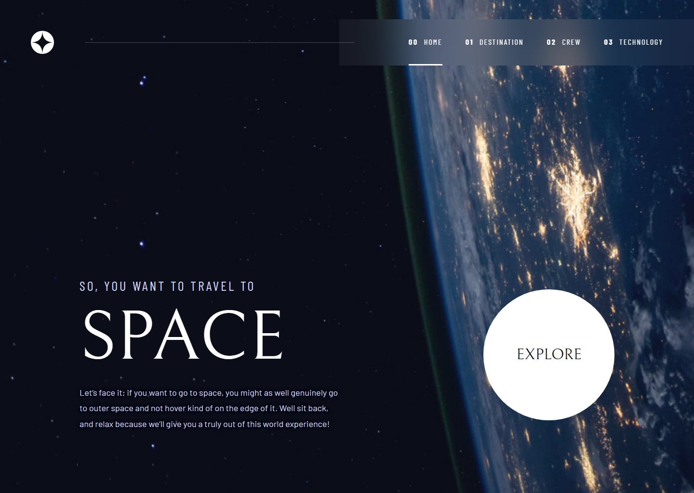

# Frontend Mentor - Space tourism website solution

This is a solution to the [Space tourism website challenge on Frontend Mentor](https://www.frontendmentor.io/challenges/space-tourism-multipage-website-gRWj1URZ3). Frontend Mentor challenges help you improve your coding skills by building realistic projects.

## Table of contents

- [Overview](#overview)
  - [The challenge](#the-challenge)
  - [Screenshot](#screenshot)
  - [Links](#links)
- [My process](#my-process)
  - [Built with](#built-with)
  - [Getting started](#getting-started)
  - [What I learned](#what-i-learned)
  - [Continued development](#continued-development)
  - [Useful resources](#useful-resources)
  - [AI Collaboration](#ai-collaboration)
- [Author](#author)
- [Acknowledgments](#acknowledgments)

## Overview

### The challenge

Users should be able to:

- View the optimal layout for each of the website's pages depending on their device's screen size
- See hover states for all interactive elements on the page
- View each page and be able to toggle between the tabs to see new information

### Screenshot



### Links

- Solution URL: [github.com/jonghwascript/space-tourism-website](https://github.com/jonghwascript/space-tourism-website)
- Live Site URL: [jonghwascript.github.io/space-tourism-website](https://jonghwascript.github.io/space-tourism-website/)

## My process

### Built with

- Semantic HTML5 markup with ARIA tabs (`tablist` / `tab` / `tabpanel`)
- Sass (SCSS modules) with a BEM-style `c-` component and `l-` layout class naming
- CSS custom properties
- Flexbox
- CSS Grid, including `subgrid`
- Mobile-first workflow with `em` breakpoints at 768px and 1024px
- Vanilla JavaScript for the mobile menu and tab switching (no frameworks or libraries)
- [Gulp](https://gulpjs.com/) with `gulp-file-include` for shared HTML partials
- [Playwright](https://playwright.dev/) scripts to measure layout, computed styles, and keyboard behavior
- [OpenSpec](https://github.com/Fission-AI/OpenSpec) to plan each change as a proposal, spec, design, and task list

### Getting started

```bash
npm install
npm run build   # clean dist, build HTML, compile SCSS, copy assets
npm run dev     # build, then serve dist on http://localhost:3000 with live reload
```

Source files live in `src/` (`pages/`, `partials/`, `scss/`, `js/`, `images/`). The `dist/` folder is generated.

### What I learned

**Keeping DOM order and visual order separate with `subgrid`.** In the markup, each tablist comes before its panel so the keyboard order is "tabs, then panel". The designs, however, place the image above the tabs (Destination, Technology on mobile) or the text before the dots (Crew). Grid placement only works on direct children, so the visible panel adopts the parent's tracks with `subgrid`, and its children can be placed around the tablist:

```scss
.c-destination__panel {
  @supports (grid-template-rows: subgrid) {
    display: grid;
    grid-row: 2 / -1;   // every row below the page title
    grid-column: 1 / -1;
    grid-template-rows: subgrid;
    grid-template-columns: subgrid;
  }
}
```

The panel box then covers the tab row, so the tablist needs `z-index: 1` to keep receiving clicks.

**Separating the hit area from the visible shape.** The Crew dots are 10–15px, but each button is a 24px target. The gap between buttons is derived from the dot size so the visible spacing still matches the design:

```scss
.c-tabs--dots {
  --dot: 0.625rem;   // 10px
  --dot-gap: 1rem;   // 16px between dots
  --space: calc(var(--dot-gap) - (1.5rem - var(--dot)));
}
```

**Driving one tab script from existing ARIA markup.** A single block in `main.js` handles all three pages: click, Enter, and Space select a tab; arrow keys, Home, and End move with automatic activation; `aria-orientation` follows the tablist's computed `flex-direction`; and `history.replaceState` swaps the URL to the matching page file so a reload keeps the selection. The styles key off `[aria-selected='true']` and `[hidden]`, so the script only changes attributes.

**Protecting template syntax from formatters.** Prettier splits an unquoted `@@if (...) { hidden}` in a start tag into separate attributes, which breaks `gulp-file-include`. A `<!-- prettier-ignore -->` comment above each such element keeps it intact.

### Continued development

- Test in Firefox, with real screen readers, and on touch devices. So far I have checked the site in Chromium only.
- Revisit the places where I kept Figma values below WCAG non-text contrast (the inactive Crew dots and Technology tab borders).
- Extract the page skeleton that the four pages repeat (two-row grid, full-height main, per-breakpoint background) into a shared rule.

### Useful resources

- [MDN: Subgrid](https://developer.mozilla.org/en-US/docs/Web/CSS/CSS_grid_layout/Subgrid) - How a nested grid can reuse its parent's tracks, which made the DOM-order and visual-order split possible.
- [WAI-ARIA Authoring Practices: Tabs Pattern](https://www.w3.org/WAI/ARIA/apg/patterns/tabs/) - Keyboard behavior and roving `tabindex` for the tab script.
- [WCAG 2.2 Understanding Target Size (Minimum)](https://www.w3.org/WAI/WCAG22/Understanding/target-size-minimum.html) - The reason for the 24px dot buttons.

### AI Collaboration

I used AI to generate the initial HTML and CSS, then reviewed and refined the implementation with a focus on semantic HTML, accessibility, and responsive layout.

I also tested the result across different screen sizes and made adjustments to improve the code's flexibility and maintainability.

This challenge helped me practice reviewing AI-generated code and making more informed frontend development decisions.

I used Claude Code throughout the project, working through an OpenSpec workflow for each page or feature.

- **Planning:** For each page it read the Figma frames, proposed a change with requirements and measurable scenarios, and asked me to decide on scope questions (for example, whether to use a slider library or style only, and how tab switching should update the URL).
- **Implementation and checks:** It wrote the SCSS and JavaScript and verified them with Playwright measurements (element boxes, computed styles, keyboard order, contrast) instead of relying on a successful build.
- **What worked well:** Writing requirements as measurable scenarios caught real bugs. Examples include a panel that intercepted tab clicks, a missing grid area, and a forced-colors border that appeared on every tab.
- **What I had to steer:** Design-versus-accessibility trade-offs, such as keeping Figma colors below contrast thresholds, were my decisions. I also reviewed commit messages before pushing.

## Author

- GitHub - [@jonghwascript](https://github.com/jonghwascript)

## Acknowledgments

Design and assets by [Frontend Mentor](https://www.frontendmentor.io). The challenge was created in collaboration with Scrimba and Kevin Powell.
